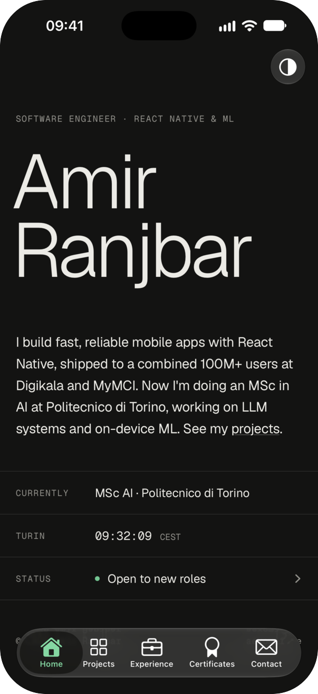

<p align="center">
  
</p>

<h1 align="center">Amir Ranjbar, as an iPhone app</h1>

<p align="center">
  A case study in turning a quiet portfolio website into a native iOS 26 app that stays in step with it.<br>
  <a href="https://aexomir.me">aexomir.me</a> · Expo SDK 58 · React Native 0.88 · iOS 26 Liquid Glass
</p>

---

## The brief

I'm a React Native engineer, and my portfolio already lived at [aexomir.me](https://aexomir.me): a calm, typographic site with five sections (home, projects, experience, certificates and contact). The goal was the same portfolio as an iPhone app, with three constraints:

1. **It should feel like iOS, not like a website in a frame.** Navigation, menus, sheets and gestures should behave the way people expect on an iPhone.
2. **It should still look like aexomir.me**: the same palette, type and voice, so the two read as one piece of work.
3. **The content must not drift.** Adding a project should update the website and the app together, without an App Store release.

## Decisions

### 1. Native where people expect it, custom only where it carries identity

Every navigation pattern uses the system component, so it gets iOS 26 behavior for free:

| Pattern | What the app uses |
|---|---|
| Floating glass tab bar that shrinks as you scroll | Expo Router `NativeTabs` with `minimizeBehavior="onScrollDown"` |
| Large titles that collapse into the nav bar | Native stack, `headerLargeTitleEnabled` |
| Project detail with swipe back | Native stack push |
| Press and hold for a preview and actions | `Link.Preview` and `Link.Menu` (UIKit context menus) |
| "Get in touch" sheet | `formSheet` sized to its content |
| Theme choice | A native bar-button menu: System, Light, Dark |

Only two things are custom, because they're part of the portfolio's character: the **bold wave** that ripples through the name on load and wherever you tap it, and the **Apps / Research switch**, whose thumb follows your finger as you swipe the list sideways.

### 2. Glass only on the navigation layer

iOS 26's Liquid Glass is striking, and that's the risk. Here glass appears only on things you touch to move around: the tab bar, bar buttons, the sheet, and the Share and GitHub buttons on a project. The content underneath stays flat, quiet and readable, which is what the website does too.

### 3. One content file for two surfaces

Both the website and the app read the same `content.json` from [aexomir/aexomir.github.io](https://github.com/aexomir/aexomir.github.io). It's edited through [Pages CMS](https://app.pagescms.org).

```
 Pages CMS ──save──▶ content.json  (aexomir.github.io, main)
                          │
          GitHub Actions  │  validate · render HTML · deploy
                          ▼
             aexomir.me  +  aexomir.me/content.json
                                     │
                                     ▼
               app: download on launch and on pull to refresh
                    → keep the last good copy on disk
                    → fall back to the copy bundled in the app
```

- **The website** is rendered to static HTML at build time, so it stays fast and fully indexable. Invalid content fails the build, and the live site keeps its last good version.
- **The app** checks every download before using it. If the network is down, or the file fails the check, you see the last good copy. On a first launch with no network, you see the bundled copy.
- **Pull to refresh** really re-downloads the content and tells you whether anything changed.

### 4. Typography carried over intact

Geist and Geist Mono, the same tokens as the site, the hairline-ruled lists and the mono uppercase labels. One compromise: the app ships Geist at fixed weights, so the name's wave steps through four weights instead of sliding smoothly as it does on the web.

## Technical highlights

- **Expo SDK 58, React Native 0.88, React Compiler on.** Shared values use Reanimated 4's `get()` / `set()` so the compiler can optimize the screens.
- **The name wave** is a `requestAnimationFrame` loop that measures each letter's center and computes its weight from its distance to an expanding wave front.
- **The swipeable filter** is a Gesture Handler pan that only activates horizontally, so vertical scrolling and pull to refresh still work. It hands the selection back to React with `scheduleOnRN` from react-native-worklets.
- **Content loading** (`src/content.tsx`) is one provider. It shows the bundled copy, then the saved copy, then the download, caching through `expo-file-system`. A shape check accepts the empty optional fields Pages CMS may write, and rejects anything that would crash a screen.
- **Theme** goes through `Appearance.setColorScheme`, so the native chrome (tab bar, menus, sheets) switches along with the app's own colors.

## Trade-offs and what's next

- **The theme choice isn't saved** between launches yet.
- **Projects have no images.** The detail screen leads with text until there's real artwork to show.
- **iPhone only.** It hasn't been tested on Android or iPad.
- **Not on TestFlight yet.** That needs the Apple developer account; the commands are below.

## Project map

```
src/
  app/                    Expo Router screens
    (tabs)/               Home · Projects · Experience · Certificates · Contact
    project/[slug].tsx    project detail
    contact-sheet.tsx     "Get in touch" form sheet
  components/             tab stack with the theme menu, context menus
  content.tsx             download, check, cache and fallback for content.json
  content.json            bundled copy (npm run sync-content)
  theme.tsx  ui.tsx       tokens, fonts, shared pieces
```

## Run it

```bash
npm install
npx expo run:ios
```

It needs a development build, not Expo Go, because it uses native modules (glass, SF Symbols, clipboard, file system). If CocoaPods fails with an encoding error, run `export LANG=en_US.UTF-8` first.

## Edit the content

Edit in Pages CMS, or change `content.json` in [aexomir/aexomir.github.io](https://github.com/aexomir/aexomir.github.io) and push to `main`. The site updates in about a minute, and the app picks the change up on its next launch or pull to refresh.

Before an App Store build, refresh the bundled copy:

```bash
npm run sync-content
```

## Ship to TestFlight

```bash
npx eas-cli@latest build --platform ios --profile production
npx eas-cli@latest submit --platform ios
```
