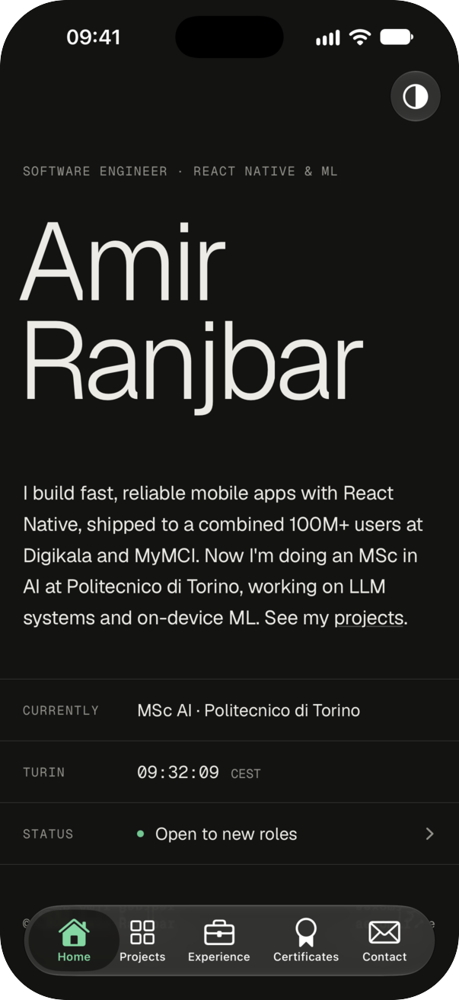

<p align="center">
  
</p>
<h1 align="center">Amir Ranjbar, as an iPhone app</h1>
<p align="center">
  My portfolio site, <a href="https://aexomir.me">aexomir.me</a>, rebuilt as a native iOS 26 app that stays in sync with it.<br>
  Expo SDK 58 · React Native 0.88 · iOS 26 Liquid Glass
</p>

## The idea

I wanted my portfolio as an iPhone app, with three rules:

1. **It should feel like iOS**, not a website in a frame.
2. **It should still look like aexomir.me**: same palette, type and voice.
3. **The content must not drift.** Adding a project should update the site and the app together, without an App Store release.

## How it's built

**Native wherever people expect it.** I used system components throughout: `NativeTabs` with a glass tab bar that shrinks on scroll, large titles, swipe back, press-and-hold previews (`Link.Preview` / `Link.Menu`), and a form sheet for "Get in touch". Glass appears only on the navigation layer; content stays flat and readable.

**Custom only where it carries identity.** There are two custom pieces:
- A bold wave that ripples through my name: a `requestAnimationFrame` loop that sets each letter's weight from its distance to the wave front.
- An Apps / Research switch whose thumb follows your finger as you swipe the list. It's a horizontal-only Gesture Handler pan, so scrolling and pull to refresh still work.

**One content file for both.** The site and the app read the same `content.json`, edited in Pages CMS:

```
Pages CMS ──save──▶ content.json (aexomir.github.io)
                        │  GitHub Actions: validate · render · deploy
                        ▼
           aexomir.me  +  aexomir.me/content.json
                                   │
                                   ▼
        app: download on launch / pull to refresh
             → keep the last good copy on disk
             → fall back to the copy bundled in the app
```

The app checks every download before using it, so a bad file or no network never breaks it. The same file also carries a maintenance banner, a new-version notice and feature switches, so I can change the app's behaviour without a release.

## Run it

```bash
npm install
npx expo run:ios
```

It needs a development build, not Expo Go. If CocoaPods fails with an encoding error, run `export LANG=en_US.UTF-8` first. Before an App Store build, refresh the bundled content with `npm run sync-content`.

## What's next

- Save the theme choice between launches.
- Add project images.
- Test on iPad and Android.
- Ship to TestFlight.

## Pipeline setup (one-time)

The **Publish app update** and **Build for TestFlight** buttons in Pages CMS run workflows in [aexomir.github.io](https://github.com/aexomir/aexomir.github.io) that call EAS. They need:

1. **An Expo project.** Run `npx eas-cli@latest init` and `npx eas-cli@latest update:configure` here, then commit `app.json`.
2. **An `EXPO_TOKEN` secret** on the site repo: `gh secret set EXPO_TOKEN --repo aexomir/aexomir.github.io`.
3. **Apple credentials.** Run the first build yourself so EAS can set them up:
   `npx eas-cli@latest build --platform ios --profile production --auto-submit`

`runtimeVersion` follows the app version, so an over-the-air update only reaches builds with the same version. Bump `version` in `app.json` whenever native code changes.
